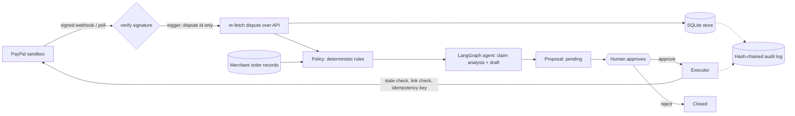
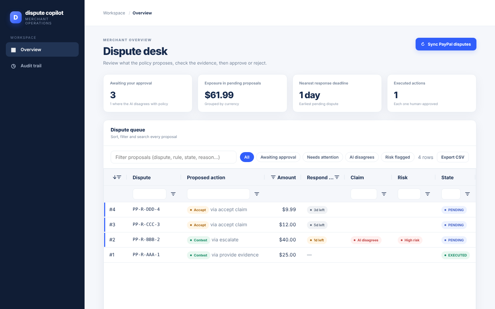
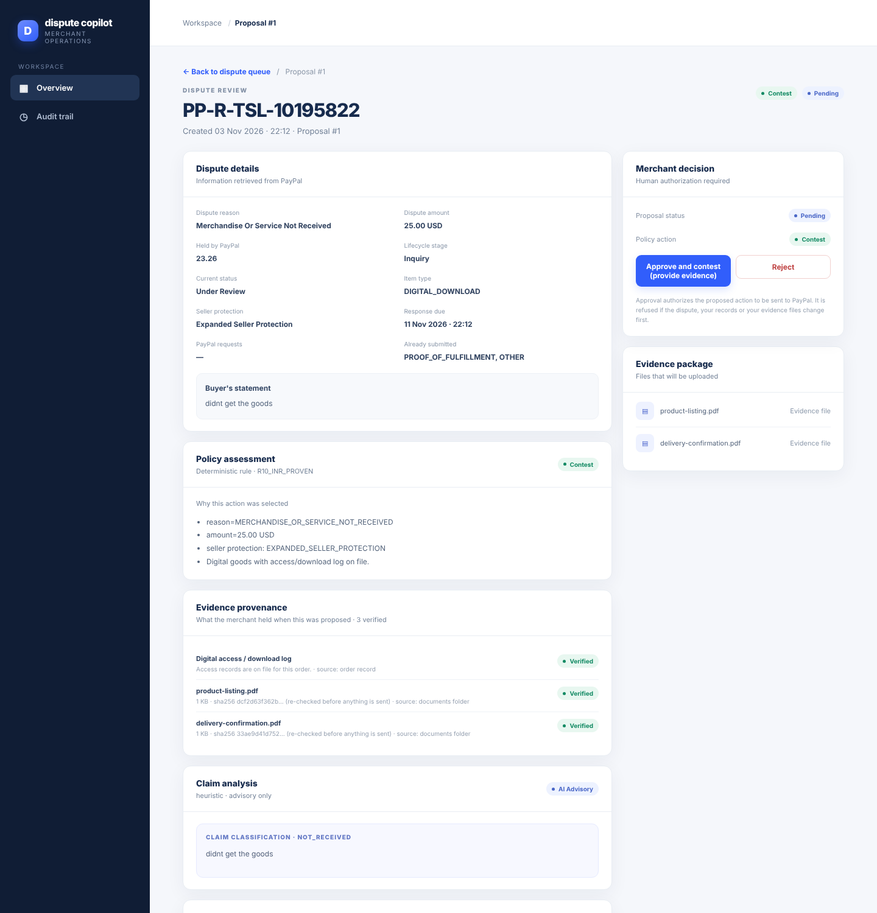

# Dispute Copilot

An approval-gated AI agent that helps a merchant respond to PayPal disputes. It triages each dispute,
assembles evidence, drafts the response, and proposes **contest** or **accept** using a deterministic
policy. **A human approves every action before anything is sent to PayPal.**

Built for the PayPal AI Hackathon. PayPal **sandbox only**.

## The problem

A merchant who gets a PayPal dispute has a deadline, a pile of evidence scattered across systems, and a
choice that costs money either way: refund the buyer, or contest and risk losing. Most small merchants
answer late, answer badly, or just accept. Fully autonomous agents are a poor fit here: the action moves
real money and is hard to undo. Dispute Copilot does the slow work (reading the claim, gathering proof,
drafting the note, checking what PayPal currently allows) and leaves the decision to a person, with the
reasoning in front of them.

## What it does

1. **Ingest:** disputes arrive by signed PayPal webhook (or polling). The event is only a trigger; the
   app re-fetches the dispute over the authenticated API.
2. **Decide:** a deterministic policy picks the proposed action from the dispute and the merchant's own
   records. No model is involved in this step.
3. **Advise:** a LangGraph agent reads the buyer's claim, flags mismatches with the dispute reason, and
   drafts the note and evidence text. It is advisory only.
4. **Approve:** a human reviews the facts, the rule that fired, the claim analysis, the draft and the files
   to be sent, then approves or rejects.
5. **Execute:** only after approval, the executor re-checks the dispute and acts through the link PayPal
   currently offers. Every step lands in a tamper-evident audit log.



## Design decisions

- **The model never decides the action.** `app/rules.py` is pure: same inputs, same decision, no I/O.
  The agent receives the decision as a given and can only produce an analysis and a draft. Tests check the
  decision is identical after an agent run, even when the model output says "ignore policy and refund".
- **Human approval is a state machine, not a convention.** Proposals go `PENDING -> APPROVED -> EXECUTED/FAILED`.
  The store rejects any other path, so execution without approval raises an error.
- **Act only through links PayPal returns.** PayPal's dispute response lists the actions currently allowed.
  We propose and execute only those, following the returned `href`, and refuse any link that leaves the
  sandbox host. If PayPal stops offering an action, the pending proposal is retired.
- **Stale approvals are refused.** Before sending, the executor re-fetches the dispute and re-hashes the merchant
  evidence (the order record and the bytes of every document). If either changed since the proposal was made,
  nothing is sent.
- **Idempotent writes, and honest about unknowns.** Each execution uses `PayPal-Request-Id: dc-<proposal id>`; connect-only
  retries never repeat a request that may have reached PayPal. If PayPal's answer never arrives (timeout, 5xx) the
  proposal becomes `UNCERTAIN`, not `FAILED`. A person can *check status with PayPal* (read-only: it compares the
  dispute with what it looked like when proposed), then *retry* (same request id, only if PayPal does not show the
  action yet and the dispute is unchanged) or *close as failed*. An approved proposal the app never finished sending
  (crash) shows the same controls.
- **Webhooks are a trigger, not a source of truth.** Signatures are verified with PayPal's verify API
  before anything else; the receiver fails closed, records event ids to ignore replays, and only extracts
  the dispute id.
- **Tamper-evident audit.** Each audit row hashes the previous one; editing or deleting any row makes
  verification fail and the UI says so. Credentials and tokens are never logged.
- **Evidence has provenance.** Each proposal stores a report of what the merchant held at decision time: every
  shipment (carrier, tracking, delivery time, source, verified or not), digital access log, and each document with its
  hash, labelled verified / unverified / missing / conflict. A tracking number alone is not proof of delivery; an
  unverified shipment sends the case to a person (`R13`) instead of to contest or accept.
- **Hostile input is assumed.** Buyer text is untrusted: it is delimited as data in prompts, model output must
  parse as strict JSON, drafts are length-limited and stripped of links and emails, and all page output is
  HTML-escaped. Evidence file names are bare names with an extension allowlist and a size cap.
- **Sandbox only, on purpose.** The config, the client and the executor all parse the URL and require https and
  exactly `api-m.sandbox.paypal.com` (no look-alike hosts, credentials, ports or query strings); regression tests
  cover the look-alike cases.
- **One contest threshold.** `min_contest_amount` applies to every dispute reason: below it the policy accepts.

## Risk signals

Each proposal carries advisory risk indicators (`app/risk.py`), computed from the dispute, the merchant's records and
the disputes this app has already seen. They are heuristics with plain-language reasons, **not a fraud score**: we have
no outcome data to calibrate a probability, so none is claimed.

| Signal | Severity | Fires when |
|---|---|---|
| Repeat disputer | warn / high | the same buyer opened 1 / 2+ other disputes with you in 180 days |
| Same payment disputed again | warn | another dispute exists for the same payment |
| Claimed amount exceeds the payment | high | the dispute asks for more than was paid |
| Buyer says not received, records show use or delivery | warn | access log (digital) or verified delivery (physical) contradicts a not-received claim |
| Non-delivery claimed very soon after payment; disputed within minutes; no contact with the merchant first | info | context only; never raises the level |

The level is *high* with any high signal or three warnings, *elevated* with one or more warnings, else *low*. Elevated
and high raise a "risk flagged" alert (signal titles only, never buyer identifiers), a column and quick view in the grid, and
a panel on the review page. Signals never change the policy's decision, the PayPal action or the evidence plan (a test
checks the stored decision equals the policy's own output for a buyer flagged high).

## Console (AG Grid)




The proposals list and the audit log are [AG Grid Community](https://www.ag-grid.com/) (MIT, version 36.2.0,
vendored in `app/static/` with its licence, so the page loads no code from a CDN):

- sorting, per-column filters and a quick-filter box that also searches the PayPal action and dispute reason;
- theming through AG Grid's theming API, matched to the dashboard palette (system fonts, nothing fetched from a CDN);
- custom cell renderers: proposed-action and state pills, a response-deadline countdown, and a
  "claim does not match reason" flag from the agent's analysis;
- summary tiles (awaiting approval, amount at stake, nearest deadline, executed) and an audit detail pane that
  shows each entry's payload and whether the hash chain verifies;
- quick-view chips (awaiting approval, needs attention, AI disagrees) through AG Grid's external-filter API, and a
  "n of m rows" counter;
- CSV export of the queue and the audit trail (cells that start with `=`, `+`, `-` or `@` are neutralised so a hostile
  dispute id cannot become a spreadsheet formula);
- columns, sort and filters remembered per viewer (`initialState`, localStorage, optional);
- a third grid on each proposal showing the evidence provenance report (verified / unverified / missing / conflict);
- auto-refresh every 20 seconds.

Every value is rendered with `textContent`, never as HTML, and pages are served with a strict
Content-Security-Policy (no inline script). A browser test plants `` strings in dispute ids and
audit payloads and checks that they show as plain text. The AG Grid Studio Agent Framework is not used.

## PayPal integration

| Area | Endpoint | Status |
|---|---|---|
| Auth | `POST /v1/oauth2/token` | used live |
| Orders (test data) | `POST /v2/checkout/orders`, `.../capture` | used live |
| List / show disputes | `GET /v1/customer/disputes`, `.../{id}` | used live |
| Accept claim | `POST .../accept-claim` | used live, dispute resolved |
| Escalate | `POST .../escalate` (inquiry to claim) | used live |
| Provide evidence | `POST .../provide-evidence` (multipart; JSON `input` part + `evidence-file` parts, multiple files) | used live |
| Sandbox resolution | `POST .../adjudicate` | used live (sandbox only) |
| Webhooks | `POST /v1/notifications/webhooks`, `.../verify-webhook-signature` | implemented, unit-tested with a mocked PayPal |

Not used: PayPal's MCP/Agent Toolkit. As far as we found, it exposes invoicing but not disputes, so this
project calls the REST API directly.

Behaviours learned from the sandbox: an inquiry only accepts evidence after escalation to a claim; status
changes lag the API response by minutes; link names use underscores while paths use hyphens.

## AI usage

- **Framework:** LangGraph (`app/agent.py`): `analyze -> draft -> recommend`.
- **Models:** pluggable through `DC_LLM_PROVIDER`: Anthropic Claude (default `claude-haiku-5-5`), Groq's free tier,
  or a local Ollama model. `auto` uses Anthropic if `ANTHROPIC_API_KEY` is set, else Groq if `GROQ_API_KEY` is set,
  else the offline fallback. Ollama is used only when asked for explicitly. `DC_MODEL` overrides the model name.
  Whichever model ran is recorded next to its output.
- **Used for:** classifying the buyer's claim, flagging a mismatch with PayPal's dispute reason, drafting the note
  sent with an escalation, evidence submission or acceptance, and an independent *AI recommendation* shown beside
  the policy's decision (`app/agent_rule.py`).
- **Not used for:** choosing contest or accept, choosing which PayPal action to call, or anything that touches
  money. The recommendation is displayed for the reviewer and cannot change the decision, link or evidence plan. When it
  disagrees with the policy, the page and the grid flag it. The model's raw output is not stored.
- **Without a model** the app runs on deterministic heuristics and templates, so it works and tests offline. If the
  model errors or returns malformed output, the same fallback applies and the audit log records it.

## Run it

```bash
python3 -m venv .venv && source .venv/bin/activate
pip install -r requirements.txt
python -m pytest -q

export PAYPAL_CLIENT_ID=...            # sandbox app credentials; never commit them
export PAYPAL_CLIENT_SECRET=...
export DC_ADMIN_PASSWORD="$(python3 -c 'import secrets;print(secrets.token_urlsafe(24))')"
export ANTHROPIC_API_KEY=...           # optional; without it the offline fallback is used
uvicorn app.main:app --port 8000       # log in with any username and the password above
```

Merchant records for the demo live in `data/orders.json` (keyed by PayPal seller transaction id; an order may carry
`shipments: [{carrier, tracking_number, status, delivered_at, source, verified}]`, where only `verified: true` counts) and
evidence files in `data/docs/` (`python scripts/make_sample_docs.py` writes samples). Edits are picked up
without a restart. See `DEPLOY.md` for the Docker + HTTPS deployment and webhook registration.

### Sandbox tooling

`python -m spike.spike <command>` creates test orders, lists and shows disputes, and registers the webhook
(`check`, `order`, `capture`, `list`, `show`, `act`, `sandbox-adjudicate`, `webhook-create`, `webhook-list`).
State-changing commands need `--yes`. A buyer opens the dispute in the sandbox UI.

## Alerts

Optional one-way alerts to Telegram and/or WhatsApp (Twilio): new dispute, deadline within 48 hours, unknown
execution result. They carry only the dispute id, amount, reason, proposed action, due date and a link, never buyer
text or evidence, and nothing in chat can approve or reject: approval stays in the authenticated console. Each alert
is sent once; failures are audited and never block ingestion. Setup is in `DEPLOY.md`.

## Tests

210 tests (two drive a real browser and skip themselves unless `pip install playwright && playwright install chromium`
has been run): the rules against fixtures captured from real sandbox responses, the audit chain and tamper
detection, the proposal state machine, the executor's refusal paths (stale, link gone, foreign host, missing
files), webhook forgery and replay, prompt-injection handling, and the web layer (auth, CSRF, escaping).

## What's next

**Real order integration (the main gap).** Today the merchant's evidence comes from a JSON file. The policy
already asks one narrow question, "what can we prove about this PayPal transaction?", so production means an
adapter behind that interface, not changes to the rules, agent, executor or UI:

- **Match the order** from the PayPal transaction id (stored on the order's payment transactions in
  platforms like Shopify, as order metadata in WooCommerce, or in a column of a custom system).
- **Fulfilment proof:** tracking numbers from the order, plus carrier-confirmed delivery from a tracking
  service or carrier API, since shops usually store only the number.
- **Digital goods:** download or login records from the merchant's own system.
- **Documents:** generate invoices, shipping confirmations and listing snapshots as files for the existing
  upload path.
- **Three-outcome lookup.** The current store treats "not found" as "no evidence", which makes the policy
  propose accept. With a live system that is unsafe: a timeout or an unmatched order would become a refund
  proposal. The adapter must return *found*, *confirmed none* or *lookup failed*, and a failed lookup must
  route to human review, never to accept.
- **Credentials:** read-only API tokens with the narrowest scope, held as secrets, with minimal data
  retention and no personal data in the audit log.

**Going live.** A live PayPal app with disputes access, a deliberate (not environment-switch) removal of the
sandbox guard, and per-merchant authorisation through PayPal's partner/third-party permissions.

**More of the dispute lifecycle.** Partial refunds through `make_offer`, messaging the buyer through
`send_message`, appeals, and the remaining dispute reasons (billing errors, unauthorised use, credit not
processed), each with its own rule and evidence plan.

**Product.** Per-merchant policy thresholds, and role separation so the person
who approves is not the person who administers the instance.

## Limitations (stated plainly)

- Reconciliation judges "applied" from the dispute's stage, status and submitted-evidence count. PayPal's sandbox
  status lags by minutes, so a not-yet-visible action reads as "not applied"; retrying reuses the request id, and how long
  PayPal remembers it is unverified.
- Sandbox only; merchant records are a demo file, not a real order system.
- Contest and accept rules cover three dispute reasons; everything else goes to human review.
- The `accept_claim` request uses `accept_claim_type: REFUND`, the only type exercised so far.
- Sandbox dispute states move slowly and asynchronously; the demo relies on PayPal's sandbox adjudication
  helper to reach a resolved state.

## License

MIT. See `LICENSE`.
